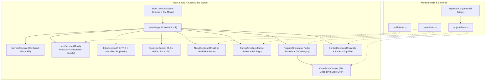

# Signal Black Executive PM Portfolio Implementation Plan

> **For agentic workers:** REQUIRED SUB-SKILL: Use superpowers:subagent-driven-development to implement this plan task-by-task. Steps use checkbox (`- [ ]`) syntax for tracking.

**Goal:** Build a production-ready, ultra-fast executive Product Manager portfolio implementing the "Signal Black Executive" design system, ready for Netlify static hosting and progressive project/video updates.

**Architecture:** Next.js 14+ App Router configured with `output: 'export'` for deterministic static generation. Tailwind CSS maps exact design tokens (colors, negative tracking, pill radii), Framer Motion powers editorial ease-outs, and a typed modular data layer (`src/data/`) provides zero-friction content management with an optional Supabase sync bridge.

**Architecture Diagram:**

**Tech Stack:** Next.js 14+, React 18+, TypeScript, Tailwind CSS, Framer Motion, Lucide React, @supabase/supabase-js, Netlify static export.

## Global Constraints
- Framework: Next.js with `output: 'export'` generating pure static assets in `out/`.
- Colors: Strictly respect `#111111` base, `#F0EFEB` about ground, `#FFFFFF` text, `#666666` secondary, `#E84020` rationed vermilion accent.
- Typography: Space Grotesk with negative tracking (`-5.9px` for display-lg, `-1.8px` for headline-md), DM Mono for eyebrows/numerals.
- Layout: Centered max-width ~1200px, 650px centered floating navbar capsule, paired 2-column or single-column density (no generic 3+ card grids).
- Content: All project videos, metrics, and case studies typed in `src/data/` for easy progressive editing.

---

### Task 1: Project Scaffolding & Design Token Setup

**Files:**
- Create: `package.json`, `tsconfig.json`, `next.config.js`, `tailwind.config.ts`, `postcss.config.js`, `netlify.toml`
- Create: `src/app/layout.tsx`, `src/app/globals.css`
- Test: Verify project compiles and runs `npm run build`

**Interfaces:**
- Produces: Base Next.js app with Tailwind theme matching all Signal Black Executive design tokens.

- [ ] **Step 1: Create package.json and project configuration files**
  Setup Next.js, React, Tailwind, Framer Motion, Lucide React, and Supabase client dependencies.
- [ ] **Step 2: Configure tailwind.config.ts with design tokens**
  Map `#111111`, `#F0EFEB`, `#E84020`, negative tracking scales (`-5.9px`, `-1.8px`), and pill radii.
- [ ] **Step 3: Setup next.config.js and netlify.toml**
  Configure `output: 'export'` for Netlify static generation.
- [ ] **Step 4: Setup src/app/layout.tsx with Google Fonts**
  Configure `Space_Grotesk` and `DM_Mono` font variables with CSS variable bindings.
- [ ] **Step 5: Verify initial build**
  Run `npm install` and verify build setup passes.

---

### Task 2: Data Models & Modular Content Layer

**Files:**
- Create: `src/types/portfolio.ts`
- Create: `src/data/profileData.ts`
- Create: `src/data/projectsData.ts`
- Create: `src/data/careerData.ts`
- Create: `src/lib/supabase.ts`

**Interfaces:**
- Produces: Strongly typed data layer for PM profile, case studies, career metrics, and video links.

- [ ] **Step 1: Define TypeScript interfaces in `src/types/portfolio.ts`**
  Types for `ProjectItem`, `CaseStudy`, `MetricItem`, `ExperienceItem`, `ProfileData`.
- [ ] **Step 2: Implement `src/data/profileData.ts`**
  Executive PM bio, core philosophy, honors list, direct channels (LinkedIn, GitHub, Email, Phone).
- [ ] **Step 3: Implement `src/data/projectsData.ts`**
  Curated PM projects with video URLs, KPI metrics, GitHub links, and deep-dive case study fields.
- [ ] **Step 4: Implement `src/data/careerData.ts`**
  Career timeline with metric bullets, date durations, and skill tags.
- [ ] **Step 5: Implement `src/lib/supabase.ts`**
  Optional Supabase client wrapper with graceful fallback to static data.

---

### Task 3: Floating Navbar Capsule & Hero Screen

**Files:**
- Create: `src/components/NavbarCapsule.tsx`
- Create: `src/components/HeroSection.tsx`

**Interfaces:**
- Consumes: `profileData.ts`
- Produces: Sticky glass capsule navbar (650px wide, `blur(20px) saturate(1.4)`) and full-bleed hero with right-pinned Honors tab, unbounded lower-left social list, and dark glass primary button.

- [ ] **Step 1: Implement `src/components/NavbarCapsule.tsx`**
  Centered floating pill (650px, 46px height), logo, 5 links, vermilion CTA pill (`#E84020`, 29px height). Mobile responsive menu toggle.
- [ ] **Step 2: Implement `src/components/HeroSection.tsx`**
  Cinematic portrait backdrop, right-edge vertical "HONORS" tab, lower-left unbounded social list, display-lg headline (`-5.9px` tracking), dark glass 50px pill button, and `scrollBob` scroll indicator.
- [ ] **Step 3: Verify visual alignment against design guardrails**
  Check navbar width (650px), backdrop blur, and dark moodily-lit hero styling.

---

### Task 4: Editorial Intro Statement & PM Expertise Grid

**Files:**
- Create: `src/components/IntroSection.tsx`
- Create: `src/components/ExpertiseSection.tsx`

**Interfaces:**
- Consumes: `profileData.ts`
- Produces: Multi-line display statement mixing white and `#E84020` words, and 2-column paired PM expertise list with DM Mono indices (`01` through `06`).

- [ ] **Step 1: Implement `src/components/IntroSection.tsx`**
  DM Mono `// INTRO` eyebrow, display-lg statement mixing white and rationed vermilion words across lines.
- [ ] **Step 2: Implement `src/components/ExpertiseSection.tsx`**
  Hairline top divider, 2-column paired grid, 6 core PM disciplines, DM Mono trailing indices.
- [ ] **Step 3: Test responsive scaling**
  Ensure typography scales smoothly from desktop to tablet and mobile.

---

### Task 5: About Section Surface Break & Metric Callout

**Files:**
- Create: `src/components/AboutSection.tsx`

**Interfaces:**
- Consumes: `profileData.ts`
- Produces: Warm light surface `#F0EFEB` break with dark ink typography, B&W portrait, overlaid vermilion credential badge, PM impact narrative, bordered stat callout (`3px solid #E84020`), and pulsing availability status dot.

- [ ] **Step 1: Implement `src/components/AboutSection.tsx`**
  Two-column split on `#F0EFEB`: B&W portrait with `#E84020` badge on left; dark ink headline and body paragraphs with bold metric emphasis on right.
- [ ] **Step 2: Add credential callout box and live status dot**
  Callout box with `3px solid #E84020` left border stripe, plus `livePulse` dot with location indicator.
- [ ] **Step 3: Verify tonal transition**
  Ensure smooth visual rhythm transitioning from black `#111111` into off-white `#F0EFEB` and back into black.

---

### Task 6: Career & Impact Timeline

**Files:**
- Create: `src/components/CareerTimeline.tsx`

**Interfaces:**
- Consumes: `careerData.ts`
- Produces: Stacked full-width career entries on `#111111` divided by hairline dividers.

- [ ] **Step 1: Implement `src/components/CareerTimeline.tsx`**
  Full-width stacked rows, vermilion index numerals, bold role headline, muted organization line, right-aligned dates.
- [ ] **Step 2: Add metric checklist & skill tags**
  Square vermilion bullet icons for metric achievements and transparent outlined pill chips for skills.

---

### Task 7: Live Experiment / Project Showcase & Case Study Drawer

**Files:**
- Create: `src/components/ProjectsShowcase.tsx`
- Create: `src/components/CaseStudyDrawer.tsx`

**Interfaces:**
- Consumes: `projectsData.ts`
- Produces: Full-viewport dark band with `01 / 09` pagination, video demo embed player, GitHub links, and slide-over PM Case Study Drawer.

- [ ] **Step 1: Implement `src/components/ProjectsShowcase.tsx`**
  `DM Mono` eyebrow `// EXPERIMENTS & PRODUCTS`, pagination `01 / 09`, featured project card with video demo player / interactive preview, metrics chips, and "Deep Dive" trigger.
- [ ] **Step 2: Implement `src/components/CaseStudyDrawer.tsx`**
  Framer Motion slide-over drawer displaying: Executive summary, Problem Statement, Hypothesis, Solution, Video walkthrough, KPIs, GitHub & PRD links.
- [ ] **Step 3: Verify interactive drawer state**
  Confirm opening/closing drawer works with smooth cubic-bezier transitions, backdrop blur, and escape key handling.

---

### Task 8: Contact Band, Footer & Page Integration

**Files:**
- Create: `src/components/ContactSection.tsx`
- Create: `src/components/FooterMarquee.tsx`
- Modify: `src/app/page.tsx`

**Interfaces:**
- Consumes: All components and data files
- Produces: 2-column contact band with image placeholder tile, pinned `#E84020` back-to-top button (2px radius), direct channels list with bordered swatches, subtle ticker, and full page assembly.

- [ ] **Step 1: Implement `src/components/ContactSection.tsx`**
  Left image tile with pinned vermilion back-to-top button; right direct channels list with bordered square swatches.
- [ ] **Step 2: Implement `src/components/FooterMarquee.tsx`**
  Subtle horizontal marquee strip at the very bottom.
- [ ] **Step 3: Assemble `src/app/page.tsx`**
  Combine Hero, Intro, Expertise, About, Career, Projects Showcase, Case Study Drawer, and Contact into one cohesive editorial flow.

---

### Task 9: Verification, Build & Netlify Export

**Files:**
- Verify: Full codebase
- Build Output: `out/`

- [ ] **Step 1: Run TypeScript type-checking**
  Execute `npx tsc --noEmit` to verify type safety.
- [ ] **Step 2: Run Next.js static build**
  Execute `npm run build` and ensure the static export completes into `out/`.
- [ ] **Step 3: Verify Netlify configuration**
  Verify `netlify.toml` maps `publish = "out"` correctly.
